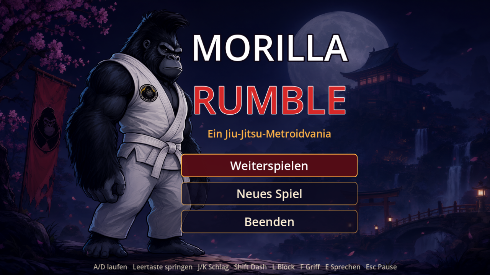
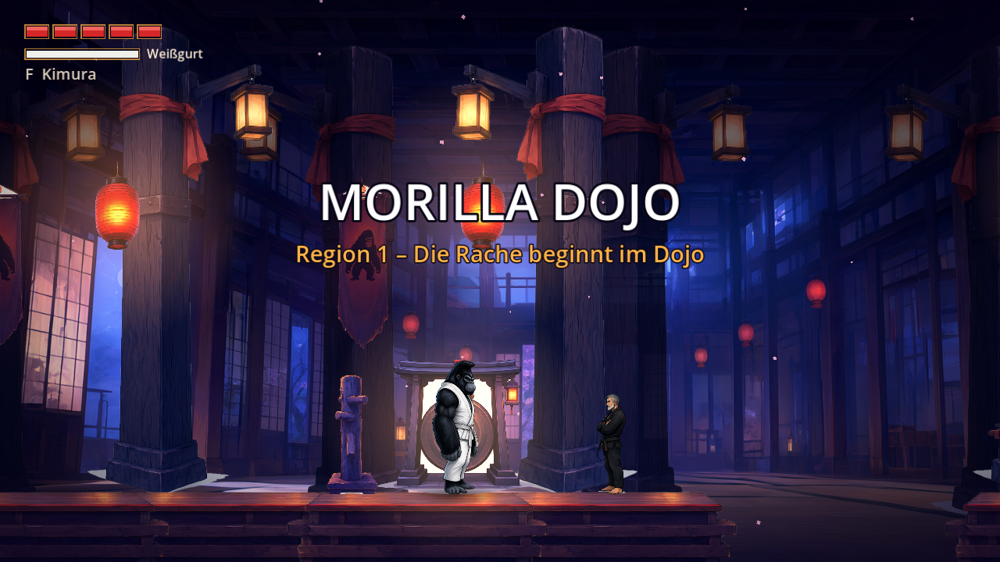
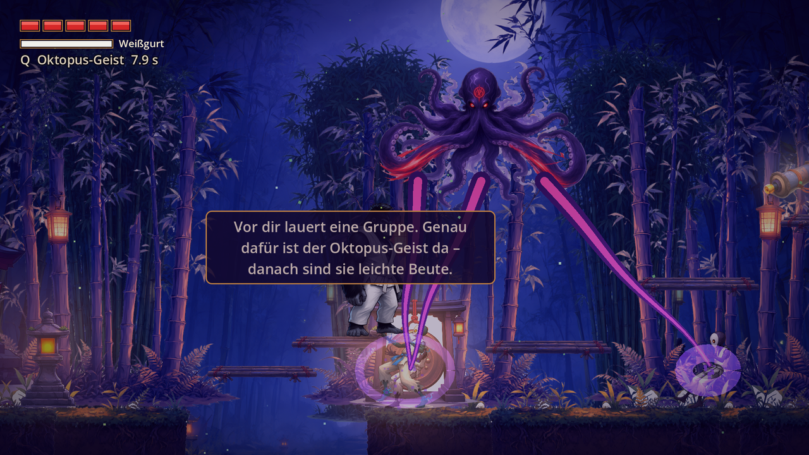

# Morilla Rumble

Ein 2D-Jiu-Jitsu-Metroidvania, gebaut mit **Godot 4.7** (GDScript, GL Compatibility).
Du spielst Morilla, einen muskulösen Gorilla im Gi, der als Weißgurt startet und sich bis zum Schwarzgurt hocharbeitet.







## Level

| Level | Inhalt |
|-------|--------|
| 1 – Morilla Dojo | Intro-Film mit Erzähler, Gespräch mit Mo, Bewegungs-Tutorial, Kimura-Lektion, Arena-Kampf |
| 2 – Mondbambus-Hain | Coach Arman führt den Oktopus-Geist vor und lehrt ihn Morilla; Gruppen aus Rekruten und blauen Rivalen, Regal-Aufstieg, Arena in zwei Wellen |

Der Oktopus-Geist (Taste **Q / R**, Gamepad: rechter Trigger) erscheint nach kurzer Konzentration, fesselt bis zu sechs Gegner gleichzeitig und setzt sie mit einer Tintenwelle für einige Sekunden außer Gefecht. Danach braucht er neun Sekunden Abklingzeit.

## Steuerung

| Aktion      | Tastatur            | Gamepad        |
|-------------|---------------------|----------------|
| Laufen      | A / D, Pfeiltasten  | D-Pad / Stick  |
| Springen    | Leertaste, W, ↑     | A              |
| Leichter Schlag | J, X            | X              |
| Schwerer Schlag | K, C            | Y              |
| Dash        | Shift, Z            | B              |
| Blocken     | L, V                | LB             |
| Griff       | F, G                | RB             |
| Oktopus-Geist | Q, R              | RT             |
| Sprechen    | E, Enter            | D-Pad hoch     |
| Pause       | Esc, P              | Start          |
| Musik an/aus| M                   | –              |

Der leichte Schlag ist eine Kombo: Wer innerhalb kurzer Zeit weiterdrückt, schlägt Jab, Cross, Hook, Lowkick und zum Abschluss einen Kick (doppelter Schaden, starker Rückstoß).

## Starten

1. [Godot 4.7](https://godotengine.org/) installieren.
2. Projektordner öffnen (`project.godot`) und F5 drücken – oder per Kommandozeile:
   ```bash
   godot --path .
   ```

## Release-Builds

Fertige Builds (Linux, Windows, macOS, Web, Android) liegen in `builds/release/`.
Neu erzeugen:

```bash
tools/build_release.sh   # exportiert alle Plattformen
tools/package_release.sh # packt die Releases
```

Der Pfad zur Godot-Binary lässt sich über die Umgebungsvariable `GODOT` setzen.

## Projektstruktur

| Ordner        | Inhalt                                         |
|---------------|------------------------------------------------|
| `assets/`     | Grafiken, Musik und Soundeffekte               |
| `autoload/`   | Globale Systeme (Game, Progression, Sound, Savegame) |
| `scenes/`     | Spieler, Gegner, Trainer, Level, UI            |
| `scripts/`    | GDScript-Logik (u. a. Zustandsmaschine des Spielers) |
| `tools/`      | Asset-/Audio-Generierung und Build-Skripte (`gen_assets.py`, `gen_level2.py`, `process_assets.py`, `gen_audio.py`) |
| `concept/`    | Konzeptbilder und Design-Dokument              |

## Screenshots neu erstellen

Screenshots entstehen direkt aus Godot (Viewport-Capture) und liegen in `docs/screenshots/`.
